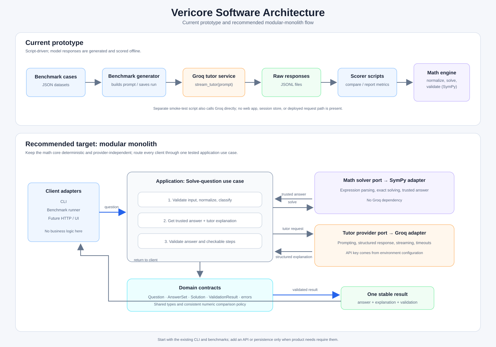

# VeriCore

VeriCore is a verification-driven AI math tutor prototype. It combines Groq-generated tutor responses with symbolic computation and answer validation using SymPy.

The current project runs through Python modules and benchmark scripts. A web interface, API server, and persistent user sessions are not implemented yet.

## Architecture



The diagram compares the current script-driven system with a proposed modular architecture. See [Software architecture](SOFTWARE_ARCHITECTURE.md) for the implementation review and recommended next steps.

| Component | Purpose |
| --- | --- |
| `Mathematical_Vericore.py` | Normalize mathematical input, compute answers, and validate solutions using SymPy. |
| `Services/Load_Model.py` | Configure the Groq client and stream tutor responses. |
| `Services/problemTypeDetector.py` | Classify questions and detect follow-up phrases. |
| `benchmarks/` | Generate model responses, score saved results, and store datasets and metrics. |
| `groq_smoke_test.py` | Check live Groq API connectivity. |

## Local setup

Use Python 3.10 or newer. From the project root in PowerShell:

```powershell
.\setup_windows.ps1
```

Create a local `.env` file containing your own credentials:

```dotenv
GROQ_API_KEY=your_api_key_here
# Optional model override:
GROQ_MODEL=openai/gpt-oss-120b
```

The `.env` file, virtual environments, and Python caches are excluded from Git. See [Local setup](LOCAL_SETUP.md) for interpreter selection and PowerShell setup details.

Check the math engine without calling the model:

```powershell
.\.venv\Scripts\python.exe -c "from Mathematical_Vericore import compute_ground_truth; print(compute_ground_truth('2 + 2'))"
```

## Benchmarks

Generate responses for the small dataset (requires Groq API access):

```powershell
.\.venv\Scripts\python.exe .\benchmarks\run_benchMarks.py --cases cases.json
```

Generate and score the high-school dataset:

```powershell
.\.venv\Scripts\python.exe .\benchmarks\run_benchMarks.py --cases high_school_100.json
.\.venv\Scripts\python.exe .\benchmarks\score_high_school.py
```

Scoring reads saved responses and does not call the model. The high-school dataset contains 100 synthetic questions across ten algebra and arithmetic topics; it does not represent the full curriculum. See [Benchmark details](benchmarks/HIGH_SCHOOL_BENCHMARK.md) for scope and scoring limitations.

## Current limitations

This is a development prototype. A correct final answer does not guarantee that every explanation step is valid: step-transition results currently do not determine the returned validation decision. Public-facing input handling and broader validation coverage also remain future work.
