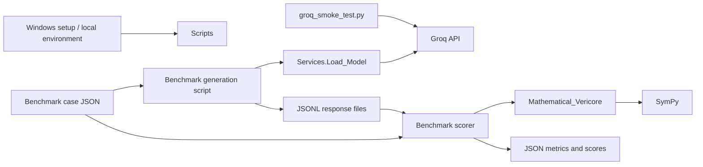
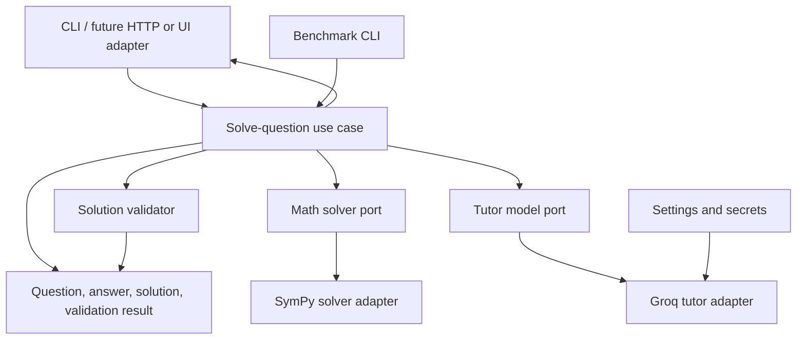

# Vericore software architecture

## Executive summary

Vericore is currently a Python math-solving and answer-validation prototype, with
Groq used to generate tutor responses and local scripts used to benchmark the
model. It is not yet a user-facing application: there is no web server, UI,
session store, or deployed runtime. The best next architecture is a **modular
monolith**. Keep the deterministic math engine independent from the LLM, put a
small application layer between tools/interfaces and those capabilities, and
add an API or persistence only when a real client or history requirement exists.
Microservices would add deployment and operational overhead without solving a
current problem.

## Current system



The flow is script-driven, not a deployed request path. The current modules are:

| Area | Responsibility | Current location |
|---|---|---|
| Math engine | Input normalization, SymPy evaluation/solving, answer parsing, answer comparison, substitution checks, and equation-step equivalence | `Mathematical_Vericore.py` |
| Problem classification | Keyword-based problem type detection and follow-up phrase detection | `Services/problemTypeDetector.py` |
| Model integration | Load Groq credentials/model configuration and stream response text | `Services/Load_Model.py` |
| Benchmarking | Generate/resume model responses, build synthetic cases, score results, and write metrics | `benchmarks/` |
| Local development | Windows virtual environment setup and editor interpreter selection | `setup_windows.ps1`, `.vscode/settings.json`, `LOCAL_SETUP.md` |

The benchmark generator calls Groq and saves raw outputs as JSONL. The scorers
read those outputs and use the math engine to assess them; scoring does not call
the model. The Groq smoke test is a separate manual connectivity check.

## Important architectural findings

1. **The solver and validator are a large, mixed-responsibility module.**
   Parsing, computation, validation, answer normalization, and output shaping
   are all in `Mathematical_Vericore.py`. This makes it difficult to test or
   evolve one responsibility without affecting the others.
2. **There is no application boundary.** Scripts call low-level functions
   directly. There is no single use case that owns the end-to-end sequence of
   parsing a question, obtaining a trusted answer, requesting an explanation,
   validating it, and returning a stable result.
3. **The LLM is not the source of truth, but the boundary is informal.**
   SymPy provides deterministic answers while Groq provides free-form streamed
   text. The benchmark prompt asks for JSON, but the model service returns text;
   parsing and schema validation happen later in scripts, inconsistently.
4. **Step validation currently does not affect the validation result.**
   `validate_solution` computes transition results for steps, but does not use
   them when deciding or returning `valid`. A caller could therefore mistake a
   correct final answer for a fully validated explanation.
5. **Error handling and output contracts are inconsistent.** The math engine
   sometimes prints errors and returns `None`, while the validator returns
   dictionaries with reason strings and the model service raises for missing
   credentials. These are reasonable prototype behaviors, but an application
   needs explicit typed success/failure results and centralized logging.
6. **Answer comparison policy varies by path.** Some paths compare floating
   values with a tolerance, while equation validation compares sets of floats
   exactly. A shared answer representation and comparison policy would avoid
   inconsistent acceptance.
7. **Input processing needs a bounded, explicit trust boundary before public
   exposure.** User expressions are normalized and passed to SymPy. Use a
   restricted expression grammar and input/compute limits rather than treating
   arbitrary input as a safe expression.
8. **Current benchmark results are encouraging but narrow.** The saved
   high-school run reports 100/100 accepted and correct, but the documented
   dataset is synthetic, uses repeated construction patterns, and covers only
   ten algebra/arithmetic topics. It has no incorrect responses in the scored
   run, so it does not measure false acceptance or rejection performance.

## Recommended target architecture

Use dependency direction **interfaces → application → domain**, with adapters
implementing external capabilities. The core math package must not depend on
Groq, an HTTP framework, or benchmark file formats.



Suggested package layout when the first code refactor is made:

```text
src/vericore/
    domain/
        models.py          # Question, AnswerSet, Solution, ValidationResult
        errors.py          # Expected domain and provider failures
    application/
        solve_question.py  # Orchestrates solve → tutor → validate
        ports.py           # MathSolver and TutorProvider interfaces
    math/
        normalize.py
        solver.py          # SymPy adapter and trusted answer generation
        validation.py      # Final-answer and step validation
    tutor/
        groq_provider.py   # Groq client, streaming, provider errors
        prompts.py
    config.py              # Environment-backed settings
tests/
benchmarks/                # Datasets, generation/scoring CLIs, result artifacts
```

This is a destination, not a recommendation to create empty layers now. A
framework-neutral application use case can serve the benchmark CLI first. If a
browser/mobile client is required, add an HTTP adapter (for example FastAPI)
around that same use case; do not put solving or Groq calls in route handlers.

## Recommended solve flow and contract

1. Validate the incoming question's type, length, and supported syntax.
2. Normalize it and determine whether it is an expression, equation, or
   supported natural-language/concept problem.
3. Compute a trusted answer with the deterministic math adapter. If that fails,
   return a specific unsupported/invalid-input result; do not ask the model to
   fabricate a trusted answer.
4. Ask the tutor provider for a structured explanation using a typed response
   schema. Keep provider streaming as a transport detail.
5. Parse and validate the model response at the boundary. Compare final answers
   using one documented numeric policy and independently validate each
   checkable step.
6. Return one stable result containing the problem type, answer, explanation,
   validation status, and actionable error details. Never report a validated
   explanation if step validation was skipped or failed.

For exact arithmetic, preserve rational values internally where possible and
convert to display numbers only at the API boundary. Keep model failures
(timeout, rate limit, malformed response) distinct from math failures and
validation failures.

## Data, configuration, and operations

- **Secrets:** continue loading `GROQ_API_KEY` from environment configuration;
  never persist it with benchmark output. Keep the model name configurable.
- **Persistence:** none is needed for the current batch workflow. If user
  accounts or conversation history are introduced, define session ownership,
  retention, and deletion before selecting a database.
- **Benchmark artifacts:** keep datasets, raw model responses, and scored
  outputs separate. Record model identifier, prompt/version, dataset hash,
  timestamp, and code version per run so results are reproducible.
- **Observability:** replace `print` calls in library code with structured
  logging at the application boundary. Do not log API keys or unnecessary
  user-provided content.
- **Execution limits:** enforce request-size and computation-time limits around
  expression parsing/solving, and provider timeouts/rate-limit handling around
  Groq calls.
- **Deployment:** local Python scripts are the only documented runtime today.
  Add a deployable service, container, or job runner only when a user-facing or
  scheduled workload is defined.

## Recommended delivery sequence

1. **Define behavior and tests:** add unit tests for normalization, supported
   math inputs, answer comparison, equation solving, malformed model output,
   and invalid/correct/incorrect solution steps. Include deliberately wrong
   responses in benchmark evaluation.
2. **Extract the math core:** split normalization, solving, answer models, and
   validation from `Mathematical_Vericore.py` without changing the existing
   script interfaces initially.
3. **Add the application use case:** move orchestration out of benchmark
   scripts; make scripts thin adapters and use a consistent structured
   response parser.
4. **Harden external boundaries:** restrict mathematical input parsing, add
   resource limits, typed errors, provider timeouts, and clear handling for
   malformed or partial model output.
5. **Add a product interface only when chosen:** expose the use case through a
   CLI, HTTP API, or UI according to actual users and authentication needs.
   Introduce persistence only for a defined history/session feature.

## Current architectural decision

**Adopt a modular monolith; do not adopt microservices yet.** The first high
value change is to separate the deterministic math/verifier from the Groq tutor
adapter and put a tested application use case between them. Preserve the
benchmark CLI as a client of that use case. This improves correctness and
testability while retaining the current local workflow.
